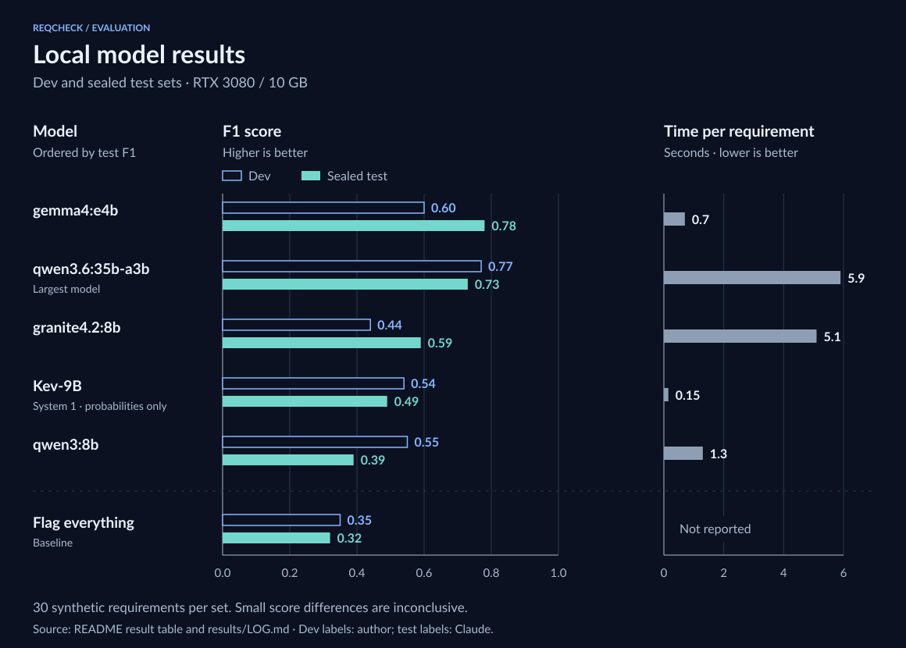

# reqcheck-eval

**[Technical overview](docs/technical.md)** · [Glossary](docs/glossary.md) · [Run log](results/LOG.md) · Try it: `make demo` ([setup](docs/running.md))

**What it is.** A requirements reviewer that runs on one workstation, with no data leaving the machine. It reads each software requirement and flags three defects, quoting the words at fault and suggesting a fix:

| Defect | Meaning | Example |
|---|---|---|
| Ambiguity | Something measurable is named, but no value | "respond **promptly**" |
| Untestable | Subjective or unlimited wording | "must be **seamless**" |
| Gap | Information a tester needs is absent | "follow **the pharmacy workflow**" (defined nowhere) |

**Why it matters.** A vague requirement lets two people build and test two different things, and the problem surfaces late. Catching it at review time is cheap.

**The real work is the measurement.** Anyone can connect an AI model and get plausible output. The question is whether the output is right, and whether a change made it better or worse. I labeled 30 requirements by hand before the agent ever ran, scored every run against them with a deterministic scorer, kept a second test set sealed until the setup was final, checked an AI grader against my own grades before trusting it, and logged every experiment, including the failures.

## Does it work?

Five local models on the same dev and sealed test sets. F1 combines "share of flags that were real" (precision) and "share of real defects caught" (recall) into one number:



<details>
<summary>Exact values</summary>

| Model | Dev set F1 (my labels) | Sealed test set F1 | Seconds per requirement |
|---|---|---|---|
| qwen3.6:35b-a3b (largest) | **0.77** | 0.73 | 5.9 |
| gemma4:e4b | 0.60 | **0.78** | 0.7 |
| qwen3:8b | 0.55 | 0.39 | 1.3 |
| granite4.2:8b | 0.44 | 0.59 | 5.1 |
| Kev-9B (System 1, see below) | 0.54 | 0.49 | **0.15** |
| *An agent that flags everything* | *0.35* | *0.32* | |

</details>

qwen3.6 is the most accurate on my own labels. gemma4:e4b matches it on the test set at an eighth of the time, so it is the practical pick for this hardware. Either is good enough as a first-pass assistant for a human reviewer, but not to run unattended.

**Kev-9B works differently.** It's a "System 1" decision model: it writes no explanation or fix, only a probability for each defect type, in a fraction of a second. That makes it the fastest by far but the least precise here. It flagged too many gaps, and its probabilities were more confident than its accuracy justified.

Two cautions. Each set has fewer than 20 real defects, so one requirement moves a score by several points; only the large gaps are meaningful. And both sets are synthetic, so real documents would score lower.

## How it works

```
requirement -> find the 3 most similar other requirements (Qdrant vector DB)
            -> prompt: labeling rules + those neighbors + this requirement
            -> local model (Ollama), answer forced into a JSON schema
            -> findings -> scorer -> precision / recall / F1
```

The model reviews every requirement; retrieval only supplies context such as "is this term defined elsewhere?" The same pipeline runs as plain Python and as an n8n workflow generated from the same prompt, and the two produced identical findings.

## What the measurement caught

- **The first version scored zero.** Asking the model for a clean/defective verdict before any reasoning made it say "clean" 29 times out of 30. Letting it reason first fixed that.
- **Over-correction.** The fix made it flag 25 of 30, scoring worse than flagging everything. Putting the written labeling rules into the prompt brought it to 0.55.
- **Overfitting.** I tuned the prompt against one model. On the sealed test set, that model dropped from 0.55 to 0.39 while gemma4 and granite improved.
- **More context hurt.** Showing the model the whole document instead of 3 neighbors lowered the score. Cause not yet isolated.
- **The AI judge failed.** I tried a second model to grade fix quality, then graded 20 fixes myself. It gave 19 of 20 the top grade; agreement corrected for chance was 0.15, so no judge scores are reported.
- **My own labels held up.** Re-labeling 10 requirements blind five days later matched 29 of 30 decisions (kappa 0.89).

## Limits

Small synthetic samples; one labeler per set (the test set was labeled by Claude, not me); five models, only one larger than ~9B; a single shared vector index; no security, monitoring or multi-user handling. It is a proof of concept.

Architecture, implementation and design decisions: [technical overview](docs/technical.md). Full run history: [results/LOG.md](results/LOG.md).
