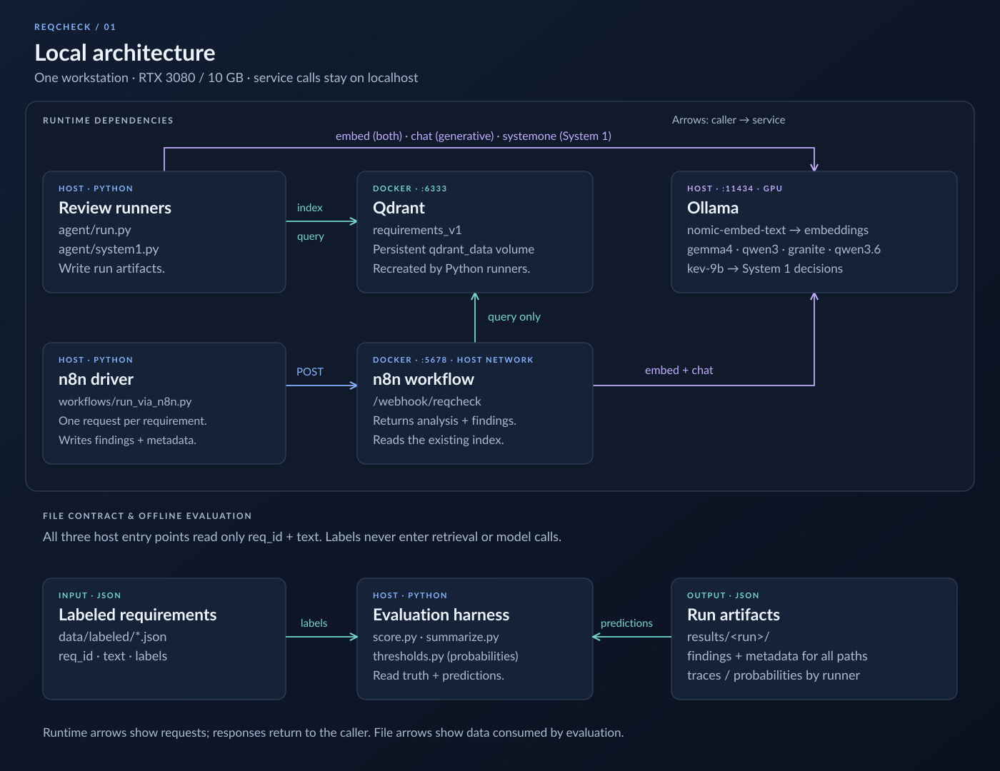
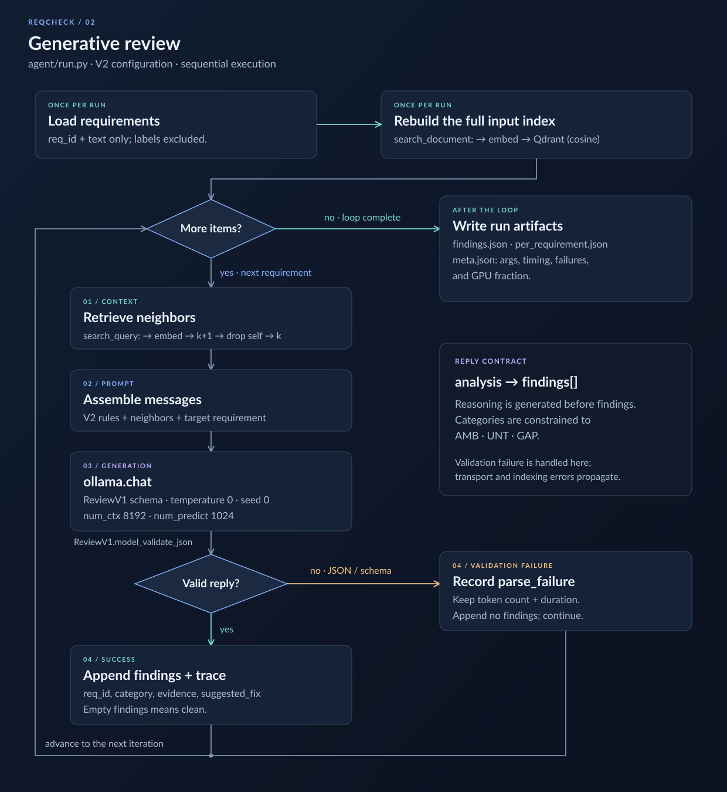
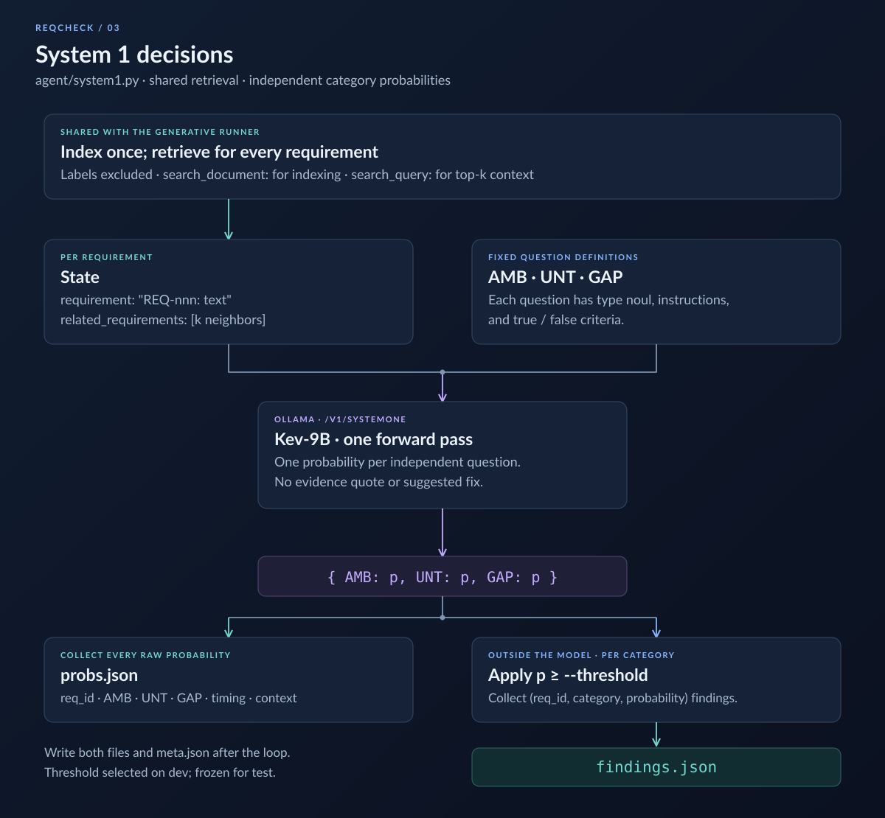
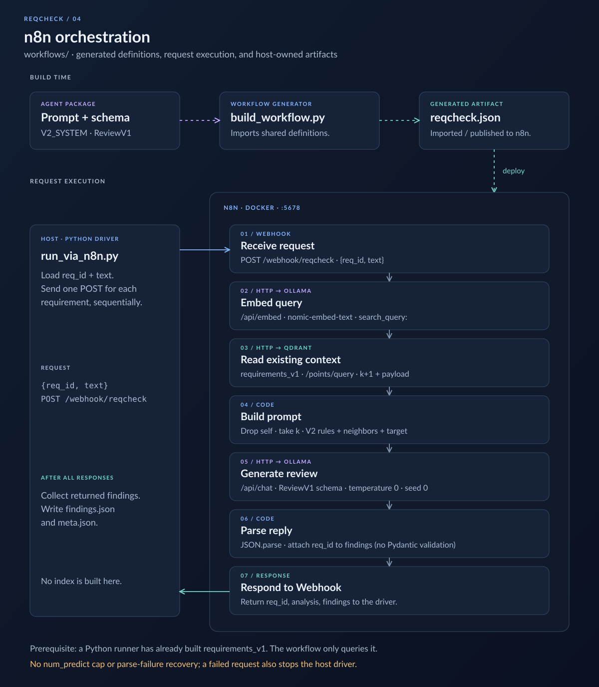

# reqcheck-eval: technical overview

How the system is built: components, data flow, contracts between stages, and the design decisions behind them. For what it does and how well it does it, see the [README](../README.md). The [glossary](glossary.md) defines terms, [running.md](running.md) has the commands, and [results/LOG.md](../results/LOG.md) has every run.

About 900 lines of Python in three packages, plus a generated n8n workflow. There is no service layer. Each stage is a CLI that reads and writes JSON files, so any stage can be rerun, swapped or inspected on its own.

## System context

| Component | Runs as | Role |
|---|---|---|
| **Ollama** | Host service (needs the GPU) | Embeddings, generative review via `/api/chat`, and System 1 decisions via `/v1/systemone` |
| **Qdrant** | Docker (`docker-compose.yml`) | Vector index of the requirement set, used to retrieve context |
| **n8n** | Docker, compose profile `n8n`, host networking | Alternative orchestrator for the same pipeline, triggered by a webhook |
| **agent/** | Python CLIs | Loading, indexing, prompting, model calls, writing run artifacts |
| **eval/** | Python CLIs + unit tests | Scoring, repeat-run statistics, threshold analysis, judge and labeler calibration |
| **workflows/** | Python | Generates the n8n workflow JSON and drives it over HTTP |

Ollama runs on the host rather than in Docker so it has direct access to the GPU driver. Everything is on localhost, so no requirement text leaves the machine.

## Module map

| Module | Responsibility |
|---|---|
| `agent/index.py` | `load_requirements` returns `(req_id, text)` only, never labels. `build_index` embeds the documents and recreates the collection. `related` returns the top-k neighbors, excluding the requirement itself. |
| `agent/prompts.py` | Versioned system prompts (`v0`, `v1`, `v2`) and the user-message builder. Changing a prompt means adding a new version so old runs stay comparable. |
| `agent/schema.py` | Pydantic models for the reply: `Finding`, `Review` (verdict first) and `ReviewV1` (analysis first). They serve as both the decoding constraint and the validator. |
| `agent/run.py` | Generative runner: index, retrieve, prompt, call Ollama, validate, write the run folder. |
| `agent/system1.py` | System 1 runner: same retrieval, then one `systemone` call per requirement that returns three probabilities. |
| `agent/modelfiles/` | Ollama Modelfile pinning Kev to an 8K context so it stays fully on the GPU. |
| `eval/score.py` | The scorer: loads truth and predictions, computes P/R/F1 overall and per category. Pure functions. |
| `eval/summarize.py` | Mean and spread of F1 across repeat runs. |
| `eval/thresholds.py` | For probability output: threshold sweep, average precision, Brier score, calibration table. |
| `eval/judge.py` | LLM-as-judge for fix quality, with a blind human grading sheet and Cohen's kappa. |
| `eval/consistency.py` | Blind relabel sheet to measure the labeler's own consistency. |
| `eval/tests/` | 16 unit tests for the scorer and the threshold metrics, on a fixture label file. |
| `workflows/build_workflow.py` | Emits `reqcheck.json` (the n8n workflow) by importing the prompt and schema from `agent/`. |
| `workflows/run_via_n8n.py` | Posts each requirement to the webhook and writes the same `findings.json` the Python runner writes. |

## Generative pipeline (`agent/run.py`)

Processing is sequential, one requirement per call. That is enough at 30 requirements per set, and it keeps timings per requirement clean.

### Design decisions

**Retrieval supplies context; it doesn't select candidates.** The model reviews every requirement. Qdrant only answers questions like "is this term defined somewhere else?" by placing the 3 nearest requirements in the prompt. An early test of searching for "vague requirements" returned requirements on similar topics, not defective ones, because embeddings capture subject matter rather than writing quality. The value of k was measured: k=3 scored 0.553, and sending the whole document (k=29) scored 0.447, with gap recall falling to zero.

**The index is rebuilt every run.** `build_index` drops and recreates `requirements_v1` from the input file. That guarantees the context never comes from a different dataset, such as test-set requirements leaking into a dev run. The tradeoff is a single shared collection, so two runs can't execute at the same time.

**Asymmetric embedding prefixes.** nomic-embed-text was trained with `search_document:` and `search_query:` task prefixes, and leaving them out degrades retrieval.

**Constrained decoding.** The pydantic model's JSON schema goes to Ollama's `format` parameter. Ollama then restricts generation to tokens that keep the output valid against the schema, and `category` is an enum (`AMB | UNT | GAP`). That removes a whole class of parsing and normalization code. The same pydantic model validates the reply afterwards.

**Field order is part of the prompt.** The model generates fields in schema order. With `verdict` first (`Review`, prompt v0), it committed to "clean" before any reasoning, 29 times out of 30, and scored F1 0.0. `ReviewV1` puts a free-text `analysis` field first, so findings come after the reasoning. An empty `findings` list means clean, so there is no separate verdict that could contradict it.

**The labeling rules are the prompt.** Prompt v2 restates the definitions, tests and tie-break order from `eval/labeling-rules.md`, but leaves out the rules' worked examples, because they are worded like dev-set items and would leak answers. This was the largest single gain (0.320 to 0.553).

**Bounded and fail-soft generation.**
- `num_ctx 8192`, because Ollama's default 4096 silently truncates long prompts.
- `num_predict 1024`, because qwen3.6 sometimes writes an `analysis` that never ends. Uncapped, one answer ran to about 30,000 characters and the invalid JSON crashed the whole run.
- With the cap, the reply fails validation, is recorded as a `parse_failure` with its token count, and counts as no findings. That is a miss in the score rather than a crash. The failures are deterministic (the same 3 of 30 on dev), so they show up in the metrics instead of being hidden.

**Reproducibility settings.** Temperature 0 and seed 0. Three repeat runs were identical for gemma4 and qwen3 and varied slightly for granite, which is why repeat runs exist and `eval/summarize.py` reports the spread.

**Every run records its environment.** `meta.json` holds every CLI argument plus wall time, the parse-failure count and `gpu_fraction` (VRAM share of the loaded model, from `ollama ps`). The GPU fraction was added after a kernel update silently pushed Ollama onto the CPU.

## System 1 pipeline (`agent/system1.py`)

Kev-9B is a decision model, not a text generator. Ollama exposes it through a separate `systemone` call:

- **Same retrieval, different contract.** Indexing and context are shared with the generative runner. The output is a probability per category, with no evidence quote, no suggested fix and no sampling settings.
- **Independent questions.** The three questions are answered separately, so the rules' "one span, one label" precedence can't be enforced. That shows up as over-flagged GAPs.
- **Thresholding happens outside the model.** `probs.json` keeps every raw probability. `findings.json` contains only the pairs at or above `--threshold`, so the existing scorer works unchanged. The threshold (0.45) was picked by sweeping on the dev set with `eval/thresholds.py`, then frozen for the test set.
- **Context pinned in a Modelfile.** The stock tag loaded with a 73K context and spilled onto the CPU. `kev-9b-8k` pins `num_ctx 8192`, so it runs 100% on the GPU, and the probabilities are identical.
- The requested NVFP4 build is an MLX (Apple Silicon) format, and Ampere GPUs have no FP4 hardware, so the Q4_K_M build of the same model is used.

## n8n pipeline (`workflows/`)

- **Generated, not hand-built.** `build_workflow.py` imports `V2_SYSTEM` and `ReviewV1.model_json_schema()` from `agent/` and writes them into the node definitions. The prompt and schema have one source of truth, so the two orchestrators can't drift.
- **Parity was checked by score, not by inspection.** The n8n run produced the same 28 (req_id, category) pairs as the Python run with the same model.
- **The workflow only reads the index.** It queries the `requirements_v1` collection built by the most recent Python run, which persists in the `qdrant_data` volume.
- **No fail-soft path.** The workflow has no `num_predict` cap and doesn't handle invalid replies, so an unbounded answer fails that request.
- `make n8n` builds the workflow, starts the container, imports and publishes the workflow through the n8n CLI, restarts n8n so the webhook registers, then runs the driver.

## Data contracts

Every stage communicates through JSON files with fixed shapes.

| File | Shape | Written by → read by |
|---|---|---|
| `data/labeled/*.json` | `{requirements: [{req_id, text, labels: [{category, evidence}] \| [] \| null}]}` | hand-written → `index.load_requirements` (text only), `score.load_truth` (labels only) |
| `findings.json` | `{findings: [{req_id, category, evidence?, suggested_fix?, probability?}]}` | all three runners → `eval/score.py` |
| `per_requirement.json` | `[{req_id, verdict, analysis, n_findings, context, prompt_tokens, seconds}]` | `agent/run.py` → debugging |
| `probs.json` | `[{req_id, AMB, UNT, GAP, seconds, context}]` | `agent/system1.py` → `eval/thresholds.py` |
| `meta.json` | CLI args + `wall_seconds`, `parse_failures`, `gpu_fraction` | runners → LOG.md, summaries |

The label convention is checked strictly. `[]` means labeled and clean, and `null` means not yet labeled. The scorer refuses to run on `null` labels, duplicate IDs or unknown categories, rather than silently treating a missing label as clean.

Label isolation is enforced in code. The agent side reads only `req_id` and `text`, and only the scorer reads `labels`.

## Evaluation harness (`eval/`)

**Scoring unit:** the `(req_id, category)` pair. Duplicate findings in the same category collapse into one. A finding in the wrong category counts as one false positive plus one false negative. The rules are versioned in [eval/matching.md](../eval/matching.md).

**Metrics:** precision, recall and F1, micro-averaged overall and reported per category. F1 is computed as `2TP / (2TP + FP + FN)`, which is defined even when precision is undefined (the agent flagged nothing). Predictions for unknown IDs or categories count as false positives. Every report sits next to the flag-everything baseline (dev 0.349, test 0.318).

**Probability metrics** (`thresholds.py`), for System 1 output:
- **Threshold sweep:** run on dev only; the test set is scored at the frozen threshold.
- **Average precision:** ranking quality, independent of the threshold.
- **Brier score:** calibration error.
- **Binned calibration table:** stated probability vs. observed rate.

**Trusting the measuring instruments:**
- `judge.py` builds a sheet of true-positive findings for blind human grading. Judge grades go to a separate `<sheet>.judge.json`, so the human never sees them, and `agree` joins the two by ID to compute Cohen's kappa. The judge scored kappa 0.15, so its grades aren't used.
- `consistency.py` does the same for the labeler: a blind relabel of a random sample, compared over 3 decisions per requirement. That scored kappa 0.89.

**Dataset discipline:**
- The dev set (30 requirements, labeled before any agent run) is used for all tuning.
- The test set (30 requirements) was sealed until the configuration was final and then run once per model.
- Thresholds and prompt choices never come from the test set.

**Tests:** `make test` runs 16 unit tests covering the scorer edge cases (empty sets, wrong category, duplicates, unknown IDs, null labels) and the threshold metrics.

## Experiment management

- **One folder per run** under `results/`, named `[test-]{prompt|s1}-{model}-k{k}-r{n}`, holding the artifacts above.
- **No artifact is overwritten.** Repeat runs get `r2` and `r3`.
- `results/LOG.md` records every run in order: hypothesis, configuration, score and conclusion, failures included.
- `results/logs/` holds the shell scripts for the long runs (for example qwen3.6, at about 3 minutes per pass).

## Runtime and deployment

- **`make demo`** is the whole setup, and each step is skipped if it's already done:
  1. check that Ollama and Docker are present
  2. create `.venv` from pinned `requirements.txt`
  3. start Qdrant (or reuse one on :6333)
  4. pull the embedding model and the review model
  5. run and score the dev set
  
  Tested from a fresh clone: 31 s, reproducing dev F1 0.595.
- **Hardware fit (RTX 3080, 10 GB):**
  - The ~8B models at Q4_K_M fit entirely in VRAM (0.7 to 5 s per requirement).
  - qwen3.6:35b-a3b is a mixture-of-experts model: 35B parameters, about 3B active per token, 22 GB on disk. It runs partly from system RAM at 5.9 s per requirement.
  - Kev answers in 0.15 s, because one forward pass replaces token-by-token generation.
- **Untested:** a cold start of `make n8n` on a machine without an existing n8n container.

## Production gaps

This is a proof of concept. Before team use, it would need:

- **Concurrency:** the shared, recreated-per-run collection would become one collection per document or run, with persistent indexing, and the sequential loop would become batched or async calls.
- **Robustness:** a retry or repair step for invalid replies, and the fail-soft path ported to the n8n workflow.
- **Operations:** authentication on the webhook, request logging and metrics, and model and prompt versions stamped on every finding.
- **Evaluation at scale:**
  - real (non-synthetic) documents
  - more labeled defects, so differences of a few points become meaningful
  - a second human labeler for inter-rater agreement
  - a judge that passes calibration before fix quality is reported
- **Scope:** it reviews the requirements that exist. Detecting a requirement that is missing entirely would need a different design, such as coverage against a checklist or a domain model.
